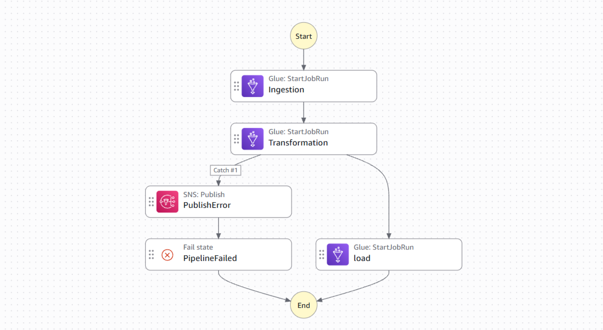

# AWS Data Engineering – Serverless Data Lake Pipeline

<p align="center">
  <b>An end-to-end AWS data engineering pipeline that transforms raw data into analytics-ready datasets using Amazon S3, AWS Glue, Apache Iceberg, and Amazon Athena.</b>
</p>

<p align="center">
  <a href="#-architecture">🏗️ Architecture</a> |
  <a href="#-features">✨ Features</a> |
  <a href="#-data-pipeline">⚙️ Data Pipeline</a> |
  <a href="#-getting-started">🚀 Getting Started</a> |
  <a href="#-roadmap">🗺️ Roadmap</a>
</p>

<p align="center">
  
  
  
</p>

<p align="center">
  
  
  
  
  
  
</p>
## Architecture

**Pipeline Flow:**


**Orchestration and Monitoring:**




## AWS Services Used

| Service | Purpose |
|---|---|
| Amazon S3 | Stores raw and processed datasets |
| AWS Glue | Serverless ETL processing |
| AWS Glue Data Catalog | Centralized metadata management |
| Apache Iceberg | ACID transactions and table management |
| Amazon Athena | SQL-based data querying |
| AWS Step Functions | ETL workflow orchestration |
| Amazon EventBridge | Scheduled pipeline execution |
| Amazon SNS | Failure notifications and email alerts |
| AWS IAM | Roles and permissions management |
| Amazon CloudWatch | Execution logs and monitoring |

## Data Architecture

The project follows the Medallion Architecture.

### 1. Bronze Layer
- Ingests source data from Amazon S3.
- Preserves the raw data structure.
- Maintains ingestion metadata.
- Supports incremental ingestion.

### 2. Silver Layer
- Performs data cleaning and standardization.
- Handles duplicate records.
- Applies data quality validations.
- Handles schema changes and data inconsistencies.
- Uses Apache Iceberg for table management and data updates.

### 3. Gold Layer
- Performs business-level transformations.
- Creates analytics-ready datasets.
- Supports downstream reporting and analytical queries.

## Key Engineering Features

- **Incremental Data Processing:** Uses watermark-based processing to identify new and updated records.
- **Medallion Architecture:** Separates raw, cleaned, and business-ready datasets.
- **Data Quality:** Implements validation checks to maintain data reliability.
- **Schema Management:** Supports controlled schema evolution and validation.
- **Apache Iceberg:** Provides ACID transactions, MERGE operations, and table-level management.
- **Workflow Orchestration:** Uses AWS Step Functions to coordinate ETL execution.
- **Automated Scheduling:** Uses Amazon EventBridge for scheduled pipeline runs.
- **Failure Notifications:** Integrates Amazon SNS to send email alerts when pipeline execution fails.

## Repository Structure

```text
aws-data-engineering-pipeline/
│
├── glue_jobs/
│   ├── bronze/
|   |----- ingestion.py
│   ├── silver/
|   |----- transformation.py
│   └── gold/
|   |----- load.py
│
├── step_functions/
│   └── etl_workflow .json
│
├── config/
│   └── job.config.json
│
├── sql/
│   └── athena_queries.sql
│
├── docs/
│   └── architecture.png
│
├── README.md
└── .gitignore
```

## Workflow Execution

1. Amazon EventBridge triggers the pipeline on a scheduled basis.
2. AWS Step Functions starts the ETL workflow.
3. AWS Glue executes the required data processing jobs.
4. Data moves through the Bronze, Silver, and Gold layers.
5. AWS Glue Data Catalog maintains table metadata.
6. Amazon Athena enables SQL-based analytical queries.
7. Step Functions handles execution failures and triggers SNS notifications.

## Technologies

- Python
- Apache Spark / PySpark
- AWS Glue
- Amazon S3
- Apache Iceberg
- AWS Step Functions
- Amazon EventBridge
- Amazon SNS
- Amazon Athena
- AWS Glue Data Catalog
- SQL
- Git & GitHub

## Project Objectives

The objective of this project is to demonstrate practical cloud data engineering concepts by building an automated, serverless ETL pipeline using AWS-native services.

It focuses on data ingestion, incremental processing, data quality, lakehouse architecture, orchestration, and reliable pipeline execution.

---

**Author:** Nithin A R

**Domain:** Data Engineering | AWS | Big Data | Lakehouse Architecture